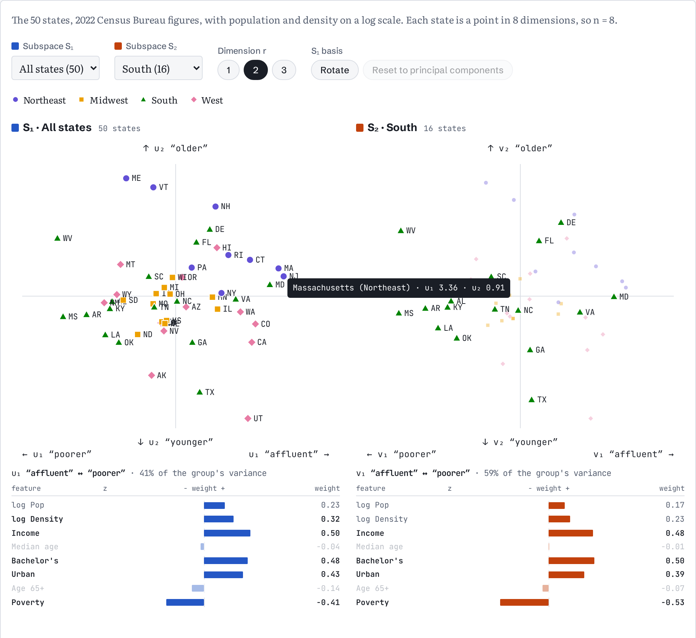

# state-subspaces

**Live page: https://rrenaud.github.io/state-subspaces/**

An interactive explainer of principal angles between subspaces: how to tell whether two groups vary along the same
directions. The example is the 50 US states, grouped by Census region. Pick two groups, and hover a state to see how
its coordinates come from its z-scores and the basis weights.

[](https://rrenaud.github.io/state-subspaces/)

## Run locally

No build step and no dependencies: open `index.html` in a browser.

```sh
node --test test/*.test.js   # math checks and the page's headline numbers
node scripts/report.js       # every number in the write-up
```
